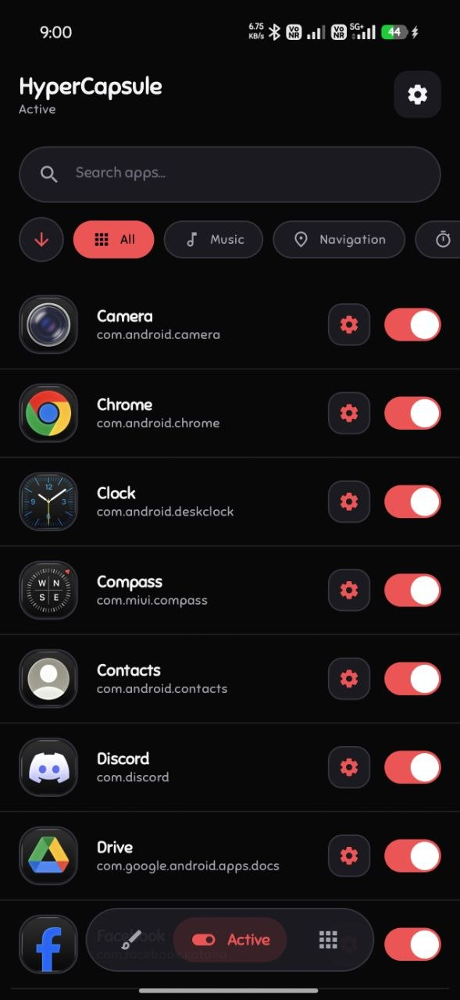
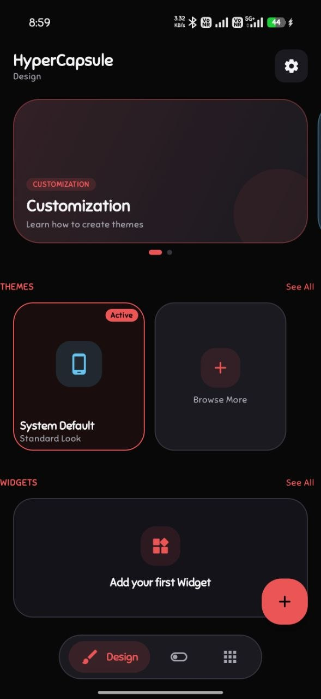
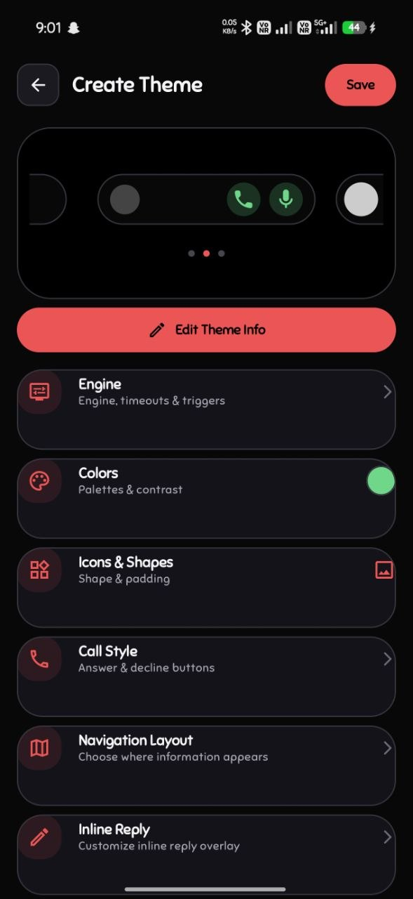
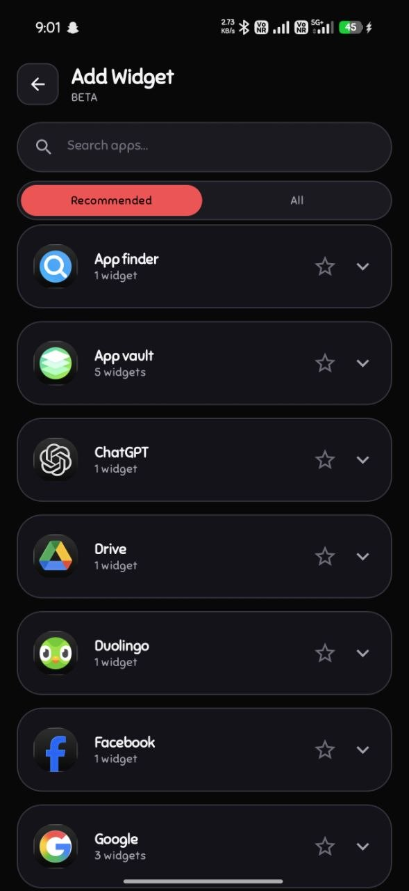
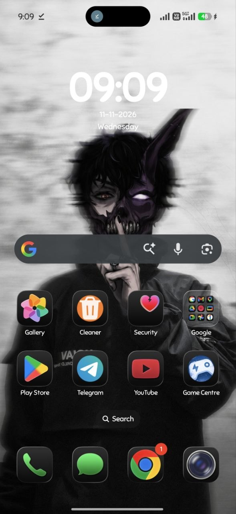

<p align="center">
  
</p>

<h1 align="center">HyperCapsule</h1>

<p align="center">
  <strong>A customizable Dynamic Island-style notification experience for Android.</strong>
  <br />
  Bringing notification activity, useful interactions and deep visual customization together in one capsule.
</p>

<p align="center">
  <a href="https://github.com/VaibhLabs/HyperCapsule/releases">
    
  </a>
  <a href="https://github.com/VaibhLabs/HyperCapsule/discussions">
    
  </a>
  <a href="https://github.com/VaibhLabs/HyperCapsule/issues">
    
  </a>
  
</p>

<p align="center">
  <sub>Developed by <a href="https://github.com/VaibhLabs">VaibhLabs</a> · Android · Kotlin · Jetpack Compose</sub>
</p>

---

## 🚀 Overview

**HyperCapsule** is an Android application that presents supported notifications and selected device activity in a customizable capsule-style interface inspired by modern Android and HyperOS experiences.

The project focuses on three core pillars:

- ⚡ **Useful at-a-glance information:** surface supported notification, media, call, navigation, download and timer activity.
- 🎨 **Deep personalization:** configure the capsule's appearance, layout, theme and per-app behaviour.
- 📱 **A considered Android experience:** combine native Android services with a custom overlay and optional advanced integrations.

HyperCapsule is designed for compatible Android devices. Features and visual behaviour can vary by Android release, manufacturer firmware, display cutout and granted permissions.

## 📱 Visual Showcase

<p align="center">
  
  
  
</p>
<p align="center">
  
  
</p>

## ✨ Feature Highlights

### ⚡ Dynamic Capsule and Notification Activity

- 🔔 Presents supported notifications in a capsule-style overlay.
- 📞 Supports specialized presentation for selected notification categories, such as calls, messages, media, downloads, navigation, timers and alarms.
- 🎛️ Provides configurable per-app behaviour and notification filtering.
- 🏝️ Includes a Permanent Island mode for an ambient capsule when no active item is being presented, subject to its configuration and device behaviour.
- 💬 Supports inline notification replies where the source application and Android notification provide a compatible reply action.

### 🎨 Personalization and Widgets

- 📐 Customizable capsule appearance, dimensions, offsets and visual styling.
- 🖌️ Theme creation and preview tools.
- 🎭 Icon shape and colour customization where supported.
- 🌈 Smart colour extraction from application icons.
- 🧩 Widget selection and island/widget overlay support, subject to Android widget and device limitations.
- 💾 Backup and restore for supported application settings.

### 🛠️ Optional Advanced Integration

- ⚡ Optional Shizuku/Sui integration for supported privileged operations.
- ⚙️ Some manufacturer-specific integrations may require additional setup and may not work on every ROM.

> ℹ️ **Compatibility note:** HyperCapsule cannot guarantee identical behaviour across all Android devices. Android permission state, OEM background restrictions, notification formats, firmware changes and third-party app behaviour can affect individual features. Check the release notes and report device-specific issues with reproducible details.

## 📥 Download and Installation

**Official downloads:** [GitHub Releases](https://github.com/VaibhLabs/HyperCapsule/releases)

1. 🌐 Open the Releases page.
2. 🏷️ Choose the release you intend to install.
3. 📖 Read its release notes and compatibility requirements.
4. 📦 Download the APK asset attached to that release.
5. 📲 Install it and follow the in-app setup instructions.
6. 🛡️ Grant only the Android permissions required for the features you choose to use.

⚠️ *Do not download unofficial or modified APKs claiming to be HyperCapsule releases.*

### 📌 Release Information

The release page is the source of truth for the latest public version, supported Android versions, known issues and downloadable artifacts. A repository source-code update does not by itself mean that a new APK has been published.

## 📋 Requirements

The current project configuration should be treated as the source of truth for build SDK values and minimum supported Android version. Before publishing a release, confirm those values in `app/build.gradle.kts` and include them in that release's notes.

For development, use:

- 🛠️ Android Studio with a compatible Android Gradle Plugin.
- ☕ JDK version supported by the Gradle wrapper and Android Gradle Plugin in this checkout (JDK 17 or 21 is expected by the current contributor notes; verify the wrapper/toolchain if upgrading).
- 📦 Android SDK platforms and build-tools required by the Gradle configuration.
- 📱 A physical Android device or emulator for testing. OEM-specific behaviour should be checked on the relevant device/ROM where possible.

## 💻 Build from Source

### 1. 📥 Clone the Repository

```bash
git clone https://github.com/VaibhLabs/HyperCapsule.git
cd HyperCapsule
```

### 2. 🔄 Open and Sync

Open the project root in Android Studio and allow Gradle sync to complete. Use the JDK configured for the project.

### 3. 🧪 Run Unit Tests

Linux / macOS:

```bash
./gradlew :app:testDebugUnitTest
```

Windows PowerShell:

```powershell
.\gradlew.bat :app:testDebugUnitTest
```

### 4. 🔨 Build a Debug APK

Linux / macOS:

```bash
./gradlew :app:assembleDebug
```

Windows PowerShell:

```powershell
.\gradlew.bat :app:assembleDebug
```

The debug APK is normally produced under:

```text
app/build/outputs/apk/debug/
```

### 5. 🔐 Build a Release APK

A release build may require the maintainer's local signing configuration and release keystore. Never commit a keystore, signing password, API token or other secret to Git.

Use the release instructions in `BUILDING.md` and the project's configured signing setup. If you are a community contributor, build and test a debug APK unless the maintainer has provided a secure release process.

## 📂 Project Structure

The project is an Android/Kotlin application. The main source areas include:

```text
HyperCapsule/
├── app/
│   └── src/
│       ├── main/
│       │   ├── aidl/                  # Privileged IPC interfaces
│       │   ├── assets/                # Bundled offline assets
│       │   ├── java/
│       │   │   └── com/hypercapsule/app/
│       │   │       ├── data/          # Persistence and preferences
│       │   │       ├── integration/   # Shizuku and system integrations
│       │   │       ├── models/        # Domain and configuration models
│       │   │       ├── receiver/      # Broadcast receivers
│       │   │       ├── service/       # Notification and overlay services
│       │   │       ├── ui/            # Compose UI, screens and navigation
│       │   │       └── util/          # Shared utilities
│       │   └── res/                   # Android resources and translations
│       ├── test/                      # Local unit tests
│       └── androidTest/               # Instrumented tests, if present
├── screenshots/                       # README and project screenshots
├── .github/
│   ├── ISSUE_TEMPLATE/                # Issue templates
│   └── workflows/                     # CI workflows
├── ARCHITECTURE.md                    # System architecture
├── BUILDING.md                        # Build and toolchain notes
├── CHANGELOG.md                       # Project change history
├── CONTRIBUTING.md                    # Contribution guide
├── COPYRIGHT.md                       # Copyright declaration
├── LICENSE                            # Project licence
├── NOTICE                             # Applicable legal notices
├── PRIVACY_POLICY.md                  # Privacy documentation
└── README.md
```

The tree above is a high-level guide; files and package boundaries may evolve. Consult the actual source tree before relying on a path.

## 🔒 Privacy and Permissions

HyperCapsule uses Android capabilities to provide notification and overlay features. Depending on the features enabled, the app may request access such as:

- 🔔 **Notification access:** to receive supported notification events and display their content in the capsule.
- 🪟 **Display over other apps:** for supported floating capsule or overlay experiences.
- 📱 **Package visibility:** to let users discover and configure apps that can interact with the capsule.
- ⚡ **Optional Shizuku/Sui authorization:** for supported advanced local system operations.

The current project manifest and implementation should be checked for the exact permissions and data flows in each release. The current project documentation describes an offline-first design and an app manifest that omits `android.permission.INTERNET`; do not assume that every future build has identical behaviour without checking its manifest and dependencies.

Read the in-app **Privacy Policy** and the repository's [`PRIVACY_POLICY.md`](PRIVACY_POLICY.md) before enabling sensitive permissions. Review permission prompts carefully and grant only what you need.

## 💬 Community, Support and Bug Reports

- 💡 **Questions and discussion:** [GitHub Discussions](https://github.com/VaibhLabs/HyperCapsule/discussions)
- 🐛 **Bug reports:** [GitHub Issues](https://github.com/VaibhLabs/HyperCapsule/issues)
- ✨ **Feature requests:** [Open a feature request](https://github.com/VaibhLabs/HyperCapsule/issues/new?template=feature_request.yml)
- 🤝 **Contributing:** [CONTRIBUTING.md](CONTRIBUTING.md)

Before opening an issue, search existing issues and discussions. Include the device model, Android version, ROM/firmware version, relevant permissions, steps to reproduce and expected versus actual behaviour. Remove personal information from logs and screenshots before uploading them.

## 📦 Releases and Versioning

Public releases are published through [GitHub Releases](https://github.com/VaibhLabs/HyperCapsule/releases).

Each release should include:

- 🏷️ A clear version and release title.
- 📝 A concise summary of new features and changes.
- 🐛 Fixed issues and known limitations.
- 📱 Minimum Android/API requirement and tested device/ROM notes, where known.
- 📦 APK filename and package/version information.
- 🔒 SHA-256 checksum for downloadable APKs.
- 🛡️ Signing information that does not expose private keys or secrets.

The repository's `CHANGELOG.md` records project changes. Release-specific notes should describe only changes actually included in the corresponding build. Do not treat an unreleased commit as a published release.

## 👩‍💻 For Developers

Contributions are welcome. Please read [`CONTRIBUTING.md`](CONTRIBUTING.md) before opening a pull request.

Good first contributions include:

- 🐛 Reproducible bug fixes.
- ♿ UI accessibility and usability improvements.
- 📱 Device/ROM compatibility fixes.
- 🔄 Notification translator improvements.
- 📖 Documentation corrections.
- 🌐 Localization improvements.
- 🧪 Tests for existing behaviour.

For architectural changes, permission changes, data handling, networking, telemetry or new third-party SDKs, open a discussion first. Such changes require careful privacy, security and compatibility review.

## ⚙️ Technology Stack

The project is built around:

- ☕ **Kotlin** (100% Kotlin codebase).
- 🤖 **Android SDK and AndroidX**.
- 🎨 **Jetpack Compose and Material 3**.
- 🔄 **Kotlin Coroutines and Flow**.
- 🗄️ **Room and DataStore** for offline persistence.
- 🔔 **Android notification and app-widget APIs**.
- ✨ **Haze** for supported glass and visual blur effects.
- ⚡ **Shizuku API** for optional privileged integration.
- 📦 **Kotlinx Serialization and Gson** for data modeling.

Exact dependency versions are defined in the Gradle build files and may change between releases.

## 📜 Licence and Third-Party Notices

HyperCapsule is distributed under the Apache License 2.0, subject to the applicable copyright notices, licence terms and third-party components included in the project.

- See [`LICENSE`](LICENSE) for the licence text.
- See [`NOTICE`](NOTICE), [`COPYRIGHT.md`](COPYRIGHT.md) and [`THIRD_PARTY_NOTICES.md`](THIRD_PARTY_NOTICES.md) for applicable notices and attribution details.

The rights and licence terms for third-party components remain governed by their respective licences.

---

<p align="center">
  <strong>HyperCapsule</strong><br />
  <sub>Designed and developed by <a href="https://github.com/VaibhLabs">VaibhLabs</a>.</sub><br />
  <sub>Build thoughtfully. Customize freely. Keep Android personal.</sub>
</p>
